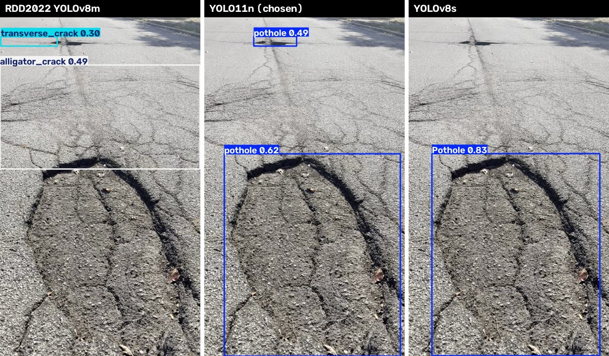
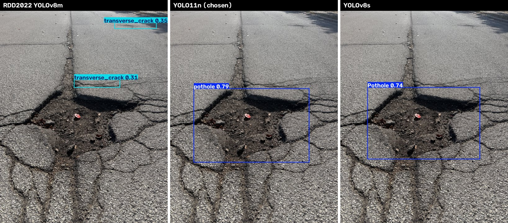
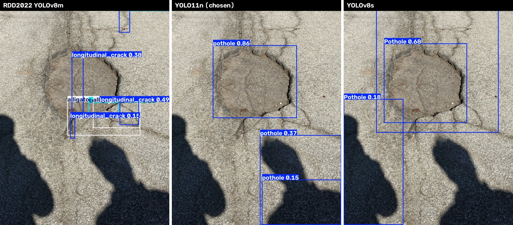

# PotholePatrol

Detecting &amp; reporting potholes.

## Project layout

| Path | Contents |
| --- | --- |
| `ios/YOLOiOSApp/Models/Detect/pothole-yolo11n.mlpackage` | Core ML model the iPhone app runs |
| `ios/YOLOiOSApp/Models/Detect/best.mlpackage` | The first model we compared, kept for reference |
| `best.mlpackage` | Copy of the original RDD2022 model, no longer used by the app |
| [`desktop/`](desktop/) | Computer version: live webcam detection and the Core ML export script |
| [`docs/model-comparison/`](docs/model-comparison/) | Side-by-side images from our model comparison |

## How the app steadies and sizes potholes

### Steady boxes

`DetectionTracker` follows each pothole across frames, so a box doesn't blink when the model misses a frame or a score hovers near the threshold. A pothole must be seen 3 times within 0.5 s to appear, then stays until it has been missing for 0.5 s. It appears at the slider's confidence and stays down to 0.10 below it.

On our 7-second phone video, this cut boxes turning on and off by 83-89% at 10, 15 and 30 FPS.

### Size

A pothole's size in pixels depends on how far away it is, so the app works out where its box sits on the road. `GroundPlaneMeasurer` uses three inputs and no distance sensor:

- The phone's height above the road, set with the on-screen control.
- The phone's tilt, from its motion sensors.
- The camera's lens data.

For each box:

1. Each box edge becomes a ray from the camera.
2. `t = h / (d · n)` finds where that ray hits the road, where `d` is the ray, `n` points straight down and `h` is the phone's height.
3. Width and length are the distances between those road points.

A pothole twice as far away looks half as wide but is measured at twice the distance, so its size comes out the same. Each pothole reports the median of its measurements, using only frames where its box is fully in view, at least 40 px wide and within 8 m. Length also requires frames within 5 m, because it's much more sensitive to box error.

To use it, mount the phone and enter its height measured with a tape. A height that's 10% off makes sizes 10% off.

### Limits of the size estimate

- It's an estimate of the box, not the hole's exact outline, and it doesn't measure depth.
- It assumes a flat road. Hills and crowned roads add error, especially at a distance.
- It hasn't been checked against tape measurements yet. Our tests only use simulated potholes, where it recovers the size to within 1% at 2-8 m.

## How we chose our model

Our first model often labeled real potholes as cracks, so we compared it with two pothole-specific models and kept the one that worked best for us.

| | RDD2022 YOLOv8m | **YOLO11n (chosen)** | YOLOv8s |
| --- | --- | --- | --- |
| Classes | 4 road damage types | Pothole only | Pothole only |
| App model size | 50 MB | 5 MB | 21 MB |

### Results

All tests used 640 px input and a 0.25 confidence threshold. We checked by eye whether each photo's boxes landed on the pothole, and the score shown is that pothole's box.

| Our test | RDD2022 YOLOv8m | **YOLO11n** | YOLOv8s |
| --- | --- | --- | --- |
| Photo: shallow pothole (`pot1`) | Missed | **Found (0.86)** | Found (0.68) |
| Photo: deep pothole (`pot2`) | Missed | **Found (0.66)** | Found (0.70) |
| Photo: `IMG_1755` | Missed | **Missed (0.22)**, plus a false alarm on a curb (0.54) | Found (0.47) |
| Photo: `IMG_1756` | Missed | **Found (0.79)** | Found (0.74) |
| Photo: `IMG_1757` | Missed | **Found (0.65)** | Found (0.60) |
| Our phone video (7 s, 221 frames): frames with a pothole box | 0% | **100%** | 76% |
| Third-party rural road clip (28 s, 692 frames): frames with a pothole box | 23% | **100%** | 99% |

The video rows count frames with any pothole box, so they include any wrong boxes. Nearly every frame in those clips shows a pothole.

We then ran all three models live on an iPhone and chose YOLO11n, which is also the smallest. All three models remain listed in `RecordViewController` (`ios/YOLOiOSApp/YOLOiOSApp/SceneDelegate.swift`). To bring the RDD2022 model back into the app's picker, set its `inPicker` to `true`. YOLOv8s isn't included in this repo because its author doesn't state a license, so using it means downloading the weights from the link below and converting them to Core ML.

### Limits of this comparison

- This is a small informal test on a handful of photos and two videos, not a measured accuracy score. We didn't hand-label the data.
- We haven't measured false alarms on undamaged roads. We did see some, including boxes on a curb, a shadow and a dirt patch.
- We haven't yet tested from a phone mounted in a moving car.

### Examples

Our phone video. The first model calls this pothole an alligator crack:

A deep pothole:

A shallow pothole:

## Credits

| Model | Source | License | Training data |
| --- | --- | --- | --- |
| YOLO11n (in use) | [`SPatel02/pothole-detection-yolo11`](https://huggingface.co/SPatel02/pothole-detection-yolo11) | AGPL-3.0 | [Pothole dataset v1](https://universe.roboflow.com/brad-dwyer/pothole-voxrl/dataset/1) by Atikur Rahman Chitholian, ODbL v1.0 |
| YOLOv8s (compared, not included) | [`Samdutse/pothole-yolov8`](https://huggingface.co/Samdutse/pothole-yolov8) | Not stated by the author | Smartathon pothole dataset |
| RDD2022 YOLOv8m (compared, also used by `desktop/`) | [`dronefreak/rdd2022-yolov8m`](https://huggingface.co/dronefreak/rdd2022-yolov8m) | AGPL-3.0 | RDD2022, CC BY-SA 4.0 |

The iPhone app is built on [Ultralytics YOLO iOS](https://github.com/ultralytics/yolo-ios-app), AGPL-3.0.
